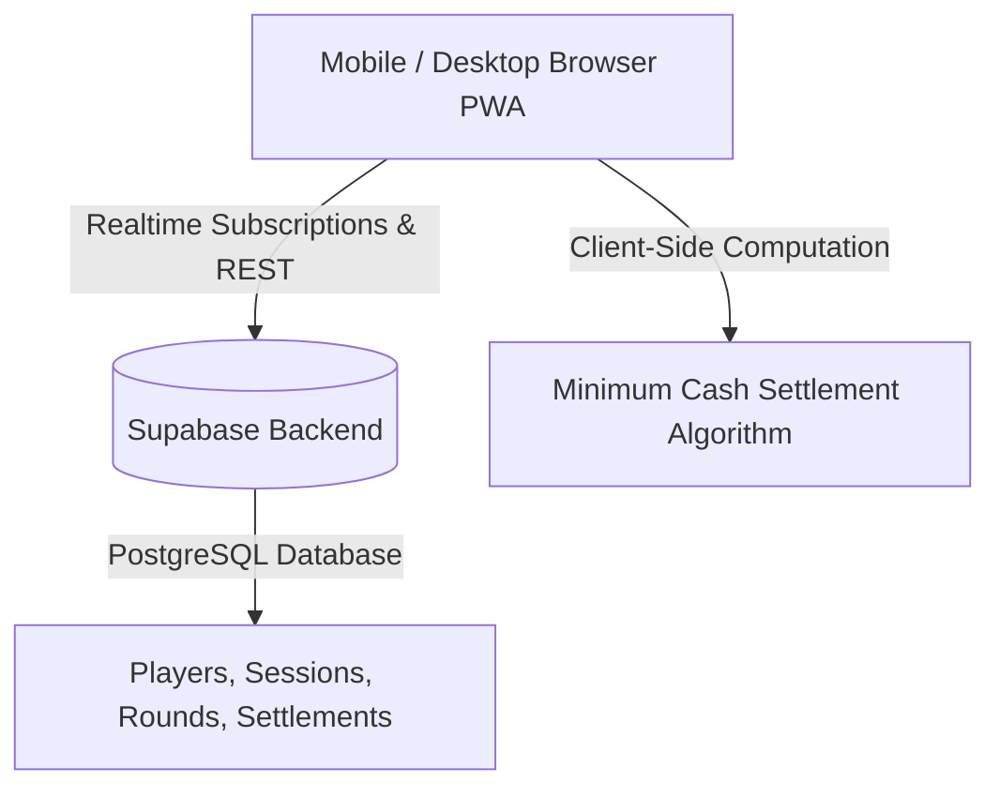

# ♠️ C54 Casino — Card Game Tracker & Minimum Transaction Settlement Engine

[](https://c54-casino.vercel.app)
[](https://supabase.com/)
[](https://c54-casino.vercel.app)
[](https://developer.mozilla.org/en-US/docs/Web/JavaScript)

**C54 Casino** is a sleek, real-time web application built for friends to track scores, token buys, round tallies, and debt settlements for **Teen Patti** and **Points Rummy**. 

It eliminates messy paper scorecards and endless "who owes whom" confusion by computing the **mathematical minimum number of payments** needed to settle all debts at the end of the night.

---

## 🌟 Key Features

### 1. ♠️ Teen Patti Session Manager
* **Configurable Token Pricing**: Set token values dynamically (e.g., ₹1, ₹0.50, or custom amounts).
* **Credit & Paid Token Tracking**: Keep track of re-buys and token counts per player throughout the game.
* **Live Session Sync**: Real-time cloud sync powered by Supabase allows multiple players to view and join an active session.
* **Pot & Token Balance Verification**: Automatically checks for token mismatches before finalizing results.

### 2. ♦️ Points Rummy Scoreboard
* **Point Value Customization**: Supports standard cash-rummy rules (e.g., ₹0.10/point).
* **Round-by-Round Tally**: Enter each player's points per round; the app computes running totals, drops, and winners automatically.
* **Historical Round Breakdown**: View previous rounds and audit point distribution at any time.

### 3. 💸 Minimum Transaction Settlement Engine
* **The Problem**: When 6 friends play, you often get a tangled web of debts where everyone is sending money to everyone else.
* **The Solution**: C54 Casino uses a **recursive subset-sum settlement algorithm** to match debtors and creditors, reducing dozens of messy debts into the **absolute fewest possible bank/UPI transfers**.
* **Partial Settlement**: Track who has paid whom and mark specific transfers as settled.

### 4. ♛ Live Leaderboards & History
* **Current vs. All-Time Mode**: Toggle between the active night's standings and all-time player rankings.
* **Filter by Game**: Filter stats across Teen Patti, Rummy, or combined earnings.
* **Game History Archive**: Revisit past games, round scores, and settlement summaries.

### 5. 📱 PWA & Dark Glassmorphism UI
* **Installable PWA**: Add to your mobile home screen (iOS and Android) for a full-screen, app-like experience with offline caching.
* **Premium Dark Aesthetic**: Styled with glassmorphism, gold accents, and smooth modal interactions.

---

## 🏗️ Architecture & Tech Stack



* **Frontend**: HTML5, Modern CSS3 (Glassmorphism & Flex/Grid), Vanilla JavaScript (ES6+ Modules)
* **Backend & Database**: [Supabase](https://supabase.com/) (PostgreSQL with Realtime WebSockets)
* **PWA Engine**: Service Worker (`sw.js`) and Web App Manifest (`manifest.json`)
* **Hosting**: [Vercel](https://vercel.com/)

---

## 📁 Repository Structure

```text
C54-Casino/
├── index.html            # Main single-page application structure
├── style.css             # Glassmorphism styling, responsive layout, dark theme
├── app.js                # Game logic, UI state machine, settlement algorithms
├── supabase-config.js    # Supabase client initialization & API keys
├── init_tables.js        # Database table initialization scripts
├── test_suite.js         # Settlement algorithm and data model test cases
├── sw.js                 # Service worker for offline caching and PWA installation
├── manifest.json         # Web App Manifest for mobile installation
└── icons/                # PWA app icons
```

---

## 🚀 Quick Start Guide (For First-Timers)

You can run this project locally on your machine in just a few minutes:

### 1. Clone the Repository
```bash
git clone https://github.com/kaustubh12022/C54-Casino.git
cd C54-Casino
```

### 2. Configure Supabase (Optional for local testing)
Open `supabase-config.js` and verify your Supabase project URL and anon public key:
```javascript
const SUPABASE_URL = 'YOUR_SUPABASE_URL';
const SUPABASE_ANON_KEY = 'YOUR_SUPABASE_ANON_KEY';
```

### 3. Launch the App
Since this is a lightweight Vanilla JS project, you do not need heavy build steps! You can open `index.html` directly in your browser, or serve it using any local HTTP server:

**Using Python:**
```bash
python -m http.server 3000
```

**Using Node.js (`npx serve`):**
```bash
npx serve .
```

Open your browser at **`http://localhost:3000`** and start your card night!

---

## 🧠 How the Settlement Algorithm Works

1. **Calculate Net Balances**:
   $$\text{Net Balance} = \text{Winnings} - \text{Total Token Buys}$$
   - Positive balance = **Creditor** (is owed money)
   - Negative balance = **Debtor** (owes money)
   - The sum of all net balances always equals zero.

2. **Subset-Sum Optimization**:
   The engine searches for exact zero-sum subsets (e.g. if Player A owes ₹50 and Player B is owed ₹50, they settle directly without involving others).

3. **Greedy Matching**:
   Remaining balances are settled by matching the largest debtor with the largest creditor until all balances are zeroed out.

---

## 📄 License

This project is open-source and available under the **MIT License**.
